# corn-keyboard-zmk-config

Configuración ZMK para mi Corne (nice!nano v2).

**Keymap interactivo (buscar teclas, ver por capa):** https://elvisozoria.github.io/corn-keyboard-zmk-config/

La imagen y la página se regeneran solas con [keymap-drawer](https://github.com/caksoylar/keymap-drawer) cada vez que cambia `config/corne.keymap` (workflow `Draw keymap`). Etiquetas legibles en `keymap-drawer/config.yaml`.
